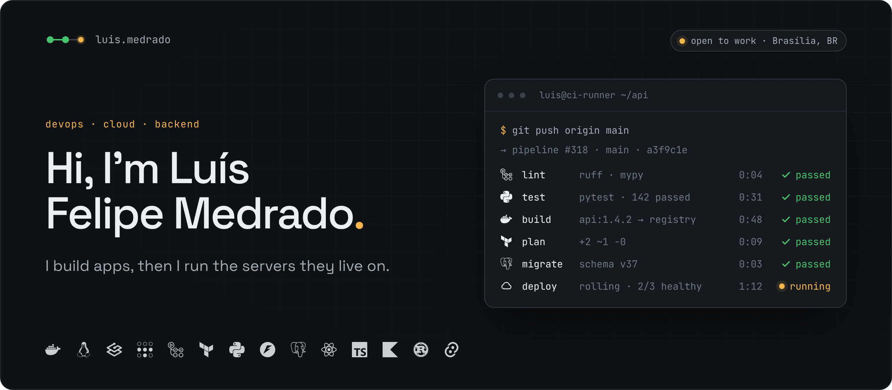
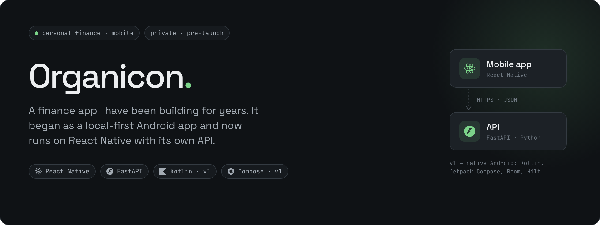
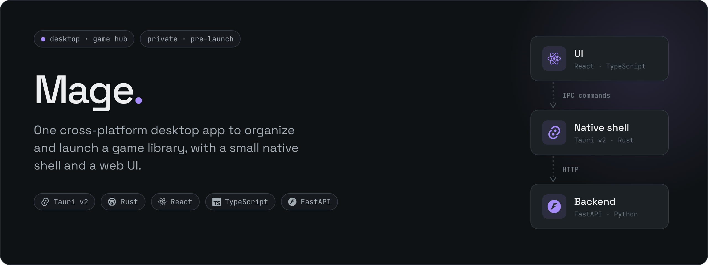
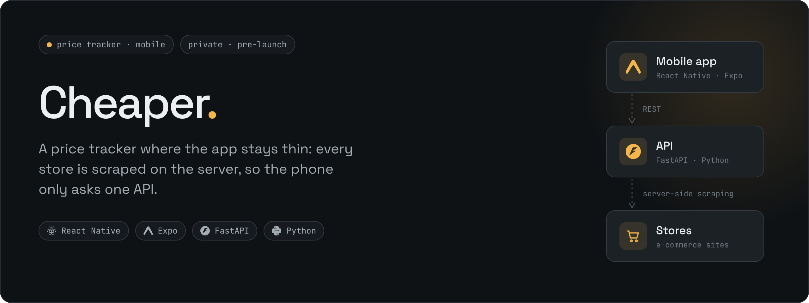

### I build apps, then I run the servers they live on.

I'm **Luís Felipe Medrado**, a Software Engineering student at Universidade Católica de Brasília (graduating in late 2026) and an IT intern at a pension fund in Brasília.

Most of what I build ends up as a backend in Python and a client in React Native or Rust. Lately I've been more interested in where that code runs, so I turned an old PC into a home server and I'm moving my career toward **DevOps and cloud**.

 

### What's running at home

It started because I wanted to send e-books to my Kindle over Wi-Fi. It's now the place where I practice infrastructure on hardware I'm responsible for.

- **Remote access without opening ports.** Every device joins a Tailscale tailnet, and the router forwards nothing. The Kindle is the one exception: Calibre-Web is published through Tailscale Funnel so it can pull books over OPDS.
- **One reverse proxy, config next to each stack.** Traefik reads Docker labels, so routing lives in the same Compose file as the service. I had to move from v3.2 to v3.6 when Docker Engine 29 changed its API version.
- **One stack per service.** Each app has its own Compose file, so adding or removing a service never touches the others. Homepage sits on top as the dashboard.
- **Waking it up from anywhere.** Tailscale works at layer 3 and can't carry a Wake-on-LAN broadcast, so an ESP32 on the LAN receives the remote trigger and sends the magic packet locally.
- **Backups on a separate disk.** borgbackup snapshots the container data and the book library to a USB drive.

 

### Things I'm building

#### Organicon

**Personal finance, rebuilt as the stack I wanted to learn.**

My longest-running project. It began as a local-first Android app (Kotlin, Jetpack Compose, Room, Hilt) and I migrated it to React Native with a FastAPI backend, which also opens the door to cloud sync between devices.

 

#### Mage

**A desktop hub for a game library.**

A cross-platform desktop app built on Tauri v2: React and TypeScript for the interface, Rust for the native side, and a FastAPI service behind it. Planned next: an observability dashboard for that backend.

 

#### Cheaper

**A price tracker that keeps the phone out of the scraping.**

React Native and Expo on the client. All e-commerce scraping happens in a FastAPI service, so a site changing its HTML means one server deploy and no app update.

> These three are private while I get them ready to launch. Happy to walk through the code in an interview.

 

### Experience

**IT Intern** · Fundação Viva de Previdência · Brasília · *current*

- Automated a monthly brand-mentions report end to end: collecting mentions, processing them, updating a dashboard and emailing the report. Together with a daily bank-statement automation, it saves the team about 190 hours a year.
- Write PostgreSQL persistence layers and reporting queries on a low-code platform: soft deletes, append-only history tables, cross-schema joins and optional-filter patterns.
- Designing an internal helpdesk for the procurement team to track active, upcoming and expired contracts.

### Education

**B.Sc. Software Engineering** · Universidade Católica de Brasília · *expected 2026*

 

### Toolbelt

| Area | Tools |
|---|---|
| **Infra** | Linux · Docker / Compose · Traefik · Tailscale · OpenMediaVault · GitHub Actions |
| **Backend** | Python · FastAPI · PostgreSQL · SQL |
| **Clients** | React Native · Expo · React · TypeScript · Kotlin / Jetpack Compose · Tauri / Rust |
| **Learning** | AWS · Terraform · CI/CD pipelines |

 

  
  

**Looking for a junior DevOps, cloud or backend role.** If your team runs its own infrastructure, I'd like to talk.
